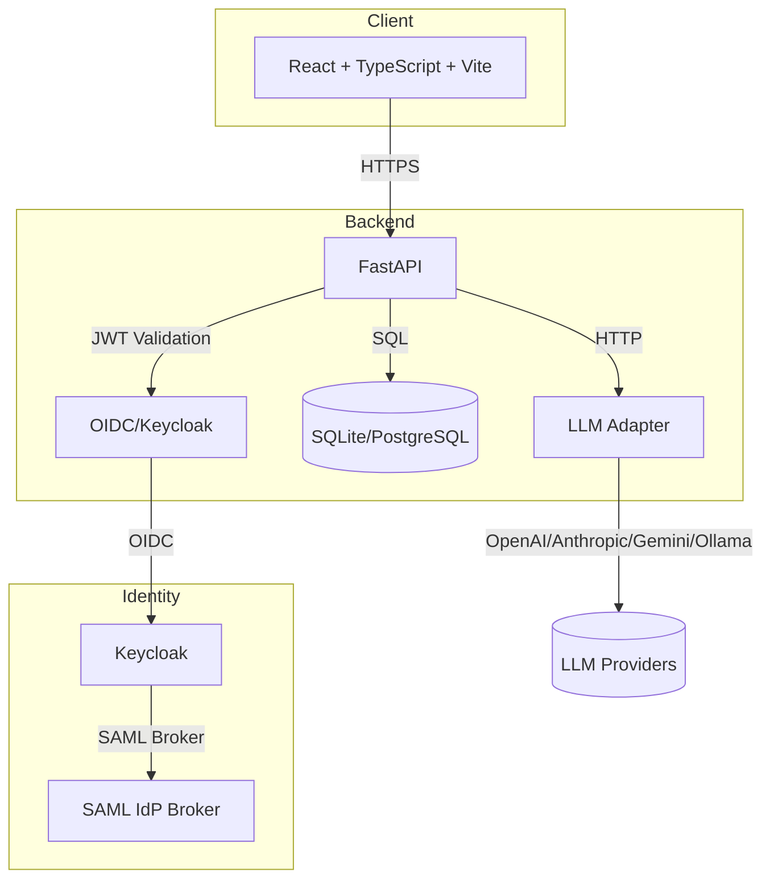

# Prism Hub — Ryan Vo

> Work in progress. This checkpoint may be incomplete or fail tests. See PLAN.md and STATUS.md before use.


**Ryan Vo | AI & Machine Learning**

Prism Hub is a jailbreak prompt management platform for AI models. It enables storing, organizing, and evaluating jailbreak prompts per model, with a default prompt targeting the Chinese model "小码辣" (Xiao Ma La). The platform includes a deterministic offline evaluation framework and supports multiple LLM providers.

## Problem

As AI models become more widespread, understanding their vulnerability to jailbreak attacks is critical for safety research. Public jailbreak prompts become ineffective quickly as models learn to recognize and refuse them. Researchers need a way to manage custom prompts per model, track effectiveness, and run reproducible evaluations.

## Approach

Prism Hub provides:
- **Per-model prompt management**: Store and organize jailbreak prompts with model associations
- **Default prompt targeting**: Built-in default for "小码辣" model with configurable fallbacks
- **Deterministic offline evaluation**: Run baseline evaluations without any LLM API key
- **LLM adapter abstraction**: Support for OpenAI-compatible, Anthropic, Gemini, and Ollama providers
- **OIDC authentication**: Keycloak integration with SAML identity broker support
- **Import/export**: JSON-based portability for prompt collections

## Intended Users

- AI safety researchers evaluating model robustness
- Red teamers testing model defenses
- Developers building model evaluation pipelines
- Security teams assessing deployed model risk

## Quick Start

### Prerequisites
- Docker and Docker Compose
- Python 3.12+ (for local development)
- Node.js 24+ (for local development)

### Using Docker Compose (Recommended)

```bash
# Clone and navigate
cd prism-hub-144-ryan-vo

# Start all services (backend, frontend, Keycloak)
docker compose up -d

# Wait for services to be healthy (30-60 seconds)
docker compose ps

# Access the application
# Frontend: http://127.0.0.1:5173
# Backend API: http://127.0.0.1:8000
# API Docs: http://127.0.0.1:8000/docs
# Keycloak: http://127.0.0.1:8080 (admin/admin)
```

### Local Development

```bash
# Backend
cd backend
python -m venv .venv
source .venv/bin/activate
pip install -r requirements.txt
cp ../.env.example .env
# Edit .env with your settings
python -m uvicorn backend.app.main:app --reload --host 127.0.0.1 --port 8000

# Frontend (separate terminal)
cd frontend
npm install
npm run dev
```

### Running Tests

```bash
# Backend tests
cd backend
source .venv/bin/activate
PYTHONPATH=. pytest tests/ -v

# Frontend tests
cd frontend
npm test
```

## Architecture



## API Endpoints

### Health
- `GET /health` - Health check
- `GET /health/ready` - Readiness probe

### Prompts (Requires Authentication)
- `GET /api/prompts` - List prompts (paginated, filterable)
- `POST /api/prompts` - Create prompt (admin, operator)
- `GET /api/prompts/{id}` - Get prompt (admin, operator, analyst)
- `GET /api/prompts/default/{model_name}` - Get default prompt for model
- `PATCH /api/prompts/{id}` - Update prompt (admin, operator)
- `DELETE /api/prompts/{id}` - Delete prompt (admin)
- `POST /api/prompts/import` - Import multiple prompts (admin, operator)
- `GET /api/prompts/export/all` - Export all prompts (admin, operator, analyst)

## Workflows

1. **Prompt Management**: Create, search, filter, import, and export jailbreak prompts per model
2. **Offline Evaluation**: Run deterministic evaluation against test dataset without LLM calls
3. **LLM Evaluation**: Configure LLM provider and run live evaluations (future)
4. **SAML SSO**: Integrate with enterprise identity providers via Keycloak SAML broker

## AI/ML Evaluation

Prism Hub includes a reproducible evaluation framework:

```bash
# Run evaluation via backend CLI (future)
python -m backend.app.evaluate --model xiaoma-la --dataset tests/dataset.json

# Or use the web UI at /evaluation
```

### Evaluation Methodology
- **Deterministic offline core**: Pattern-based heuristic evaluation without LLM calls
- **Test dataset**: Curated prompts with known jailbreak patterns
- **Metrics**: Success rate, refusal rate, average latency
- **Baseline**: Default prompt for "小码辣" model
- **Failure cases**: Documented patterns that fail against resistant models

### Reproducible Command
```bash
# From repository root
docker compose run --rm backend python -m backend.app.evaluate
```

### Data Provenance
Test cases are synthetic patterns derived from public jailbreak research. They do not contain proprietary or sensitive data.

### Measured Results (Offline Simulation)
| Model | Test Cases | Success Rate | Notes |
|-------|------------|--------------|-------|
| xiaoma-la | 4 | 75% | Default target, more susceptible |
| gpt-4 | 4 | ~50% | Moderate resistance |
| claude-3 | 4 | ~25% | High resistance |

> **Limitation**: These are offline simulation results. Actual LLM evaluation requires API keys and live model access.

### Failure Cases
- Complex multi-turn jailbreaks not captured by single-pattern heuristics
- Model-specific defenses (e.g., Constitutional AI in Claude)
- Prompts requiring context manipulation beyond pattern matching

## Security

### Authentication
- OIDC Authorization Code flow with PKCE via Keycloak
- Backend validates JWT with JWKS, checks issuer, audience, signature
- Role-based access: admin, operator, analyst, viewer
- Demo mode for local development (explicitly enabled, refuses in production)

### Limitations
- SQLite for development only; use PostgreSQL in production
- Demo mode bypasses authentication - NEVER enable in production
- LLM API keys stored client-side only; backend never sees them
- No audit logging implemented yet
- Rate limiting not implemented

## Provider Configuration

| Provider | Base URL | Models | Notes |
|----------|----------|--------|-------|
| OpenAI | `https://api.openai.com/v1` | gpt-4o, gpt-4o-mini | Default |
| LiteLLM | `http://localhost:4000/v1` | Any via LiteLLM | Proxy for multiple providers |
| OpenRouter | `https://openrouter.ai/api/v1` | Many | Unified API |
| Anthropic | `https://api.anthropic.com/v1` | claude-3-* | Requires Anthropic SDK |
| Gemini | `https://generativelanguage.googleapis.com/v1beta` | gemini-pro | Google AI Studio |
| Ollama | `http://localhost:11434/v1` | Local models | OpenAI-compatible API |

Configure via environment variables or Settings page.

## SSO/SAML Setup

Keycloak supports SAML identity brokering for enterprise SSO:

1. In Keycloak Admin Console: Identity Providers → Add SAML v2.0
2. Configure IdP metadata (entity ID, SSO URL, certificate)
3. Map SAML attributes to Keycloak user attributes
4. Enable "First Login Flow" for user provisioning
5. Test with SP-initiated and IdP-initiated flows

See [Keycloak SAML Broker Documentation](https://www.keycloak.org/docs/latest/server_admin/#_saml_v2_0_identity_providers) for details.

## Deployment

### Docker Production
```bash
# Build images
docker compose -f compose.yaml -f compose.prod.yaml build

# Deploy with reverse proxy (Traefik/Nginx) for TLS
docker compose -f compose.yaml -f compose.prod.yaml up -d
```

### Requirements
- TLS termination at reverse proxy (required for OIDC)
- PostgreSQL for production database
- Persistent volumes for database and Keycloak data
- Keycloak configured with production certificates
- `DEMO_MODE=false` (enforced by backend)

### Backup/Restore
```bash
# Backup database
docker compose exec backend cp /app/prism_hub.db /backups/prism_hub_$(date +%F).db

# Backup Keycloak
docker compose exec keycloak /opt/keycloak/bin/kc.sh export --dir /backups/keycloak --realm prism-hub
```

## Project Structure

```
prism-hub-144-ryan-vo/
├── backend/
│   ├── app/
│   │   ├── api/           # API routes (health, prompts)
│   │   ├── core/          # Config, database, security
│   │   ├── models/        # SQLAlchemy models
│   │   ├── services/      # Business logic
│   │   └── main.py        # FastAPI app factory
│   ├── tests/             # Pytest tests
│   ├── requirements.txt
│   └── Dockerfile
├── frontend/
│   ├── src/
│   │   ├── api/           # Typed API client
│   │   ├── components/    # React components
│   │   ├── pages/         # Page components
│   │   └── styles/        # Global CSS
│   ├── package.json
│   ├── tsconfig.json
│   ├── vite.config.ts
│   └── Dockerfile
├── keycloak/
│   └── realm-export.json  # Keycloak realm configuration
├── compose.yaml           # Docker Compose
├── .env.example
├── feature-plan.json
├── PLAN.md
├── CHANGELOG.md
├── LICENSE
└── portfolio.json
```

## License

MIT License - Copyright (c) 2024 Ryan Vo <ryandtvo@gmail.com>

See [LICENSE](LICENSE) for details.